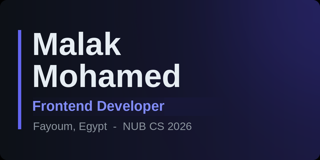
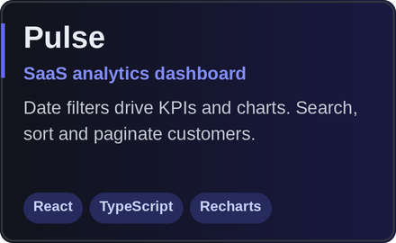
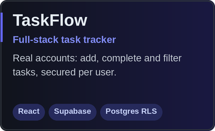
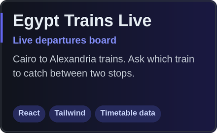
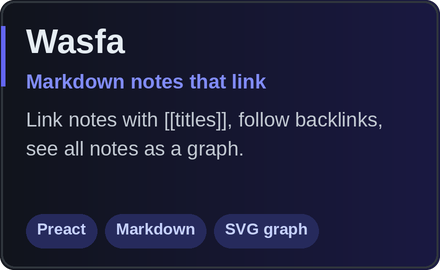

  

  Junior frontend developer from Fayoum, Egypt. I build responsive, accessible web apps with React and TypeScript. 
  Looking for my first junior frontend role, remote-friendly.

  
  
  

  
  
  
  
  
  
  

   
  <a href="https://malakmo7amed309.github.io/pulse/">Live demo</a> &nbsp;|&nbsp; <a href="https://github.com/malakmo7amed309/pulse">Code</a>

   
  <a href="https://malakmo7amed309.github.io/task-tracker/">Live demo</a> &nbsp;|&nbsp; <a href="https://github.com/malakmo7amed309/task-tracker">Code</a>

   
  <a href="https://malakmo7amed309.github.io/egypt-trains/">Live demo</a> &nbsp;|&nbsp; <a href="https://github.com/malakmo7amed309/egypt-trains">Code</a>

   
  <a href="https://malakmo7amed309.github.io/wasfa/">Live demo</a> &nbsp;|&nbsp; <a href="https://github.com/malakmo7amed309/wasfa">Code</a>

More projects on my <a href="https://malakmo7amed309.github.io">portfolio</a>

  <a href="mailto:malakmo7amed309@gmail.com">malakmo7amed309@gmail.com</a> &nbsp;|&nbsp;
  <a href="https://linkedin.com/in/malak-mohamed-3b8533374">LinkedIn</a> &nbsp;|&nbsp;
  <a href="https://malakmo7amed309.github.io">Portfolio</a>

